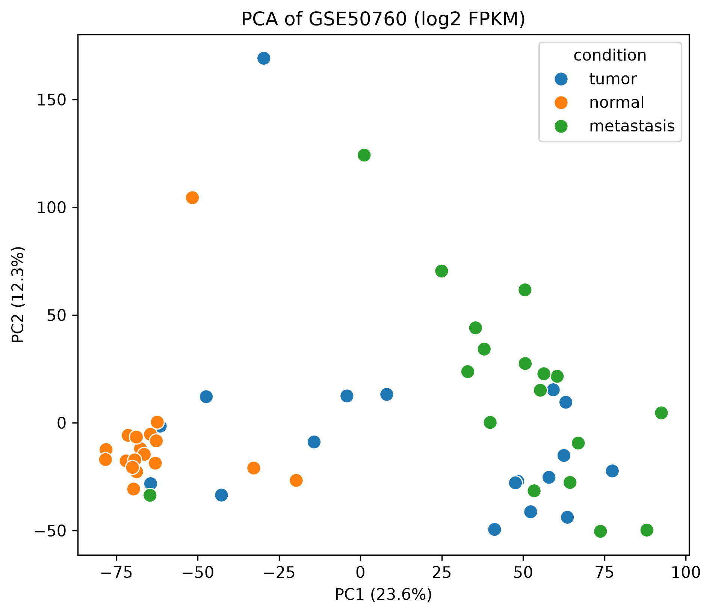
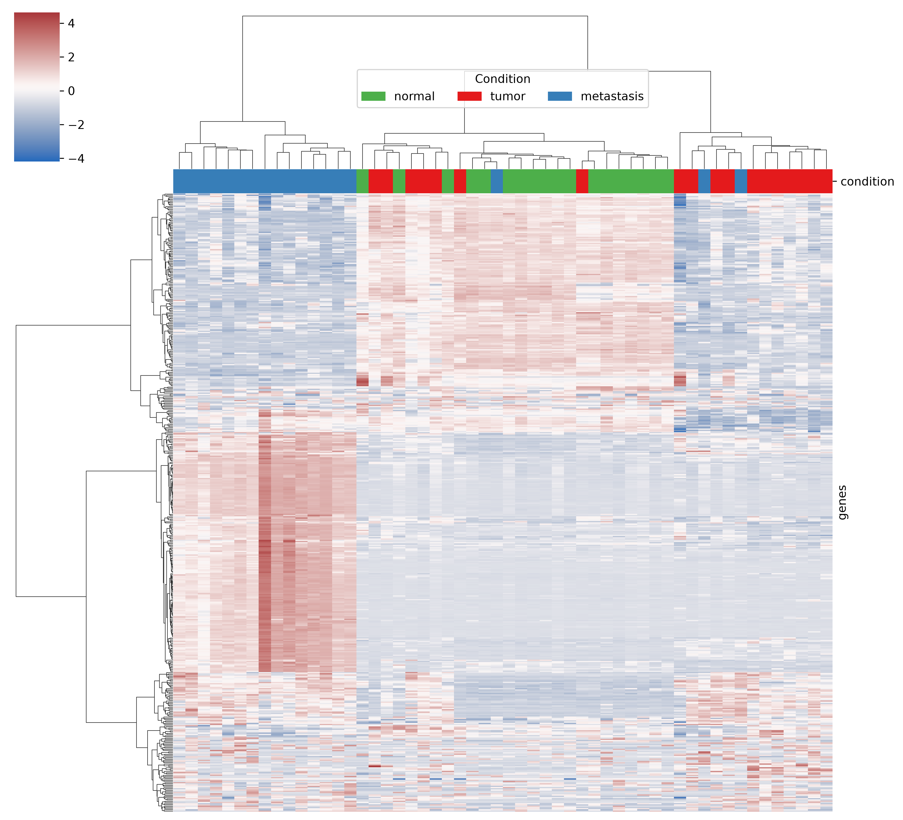
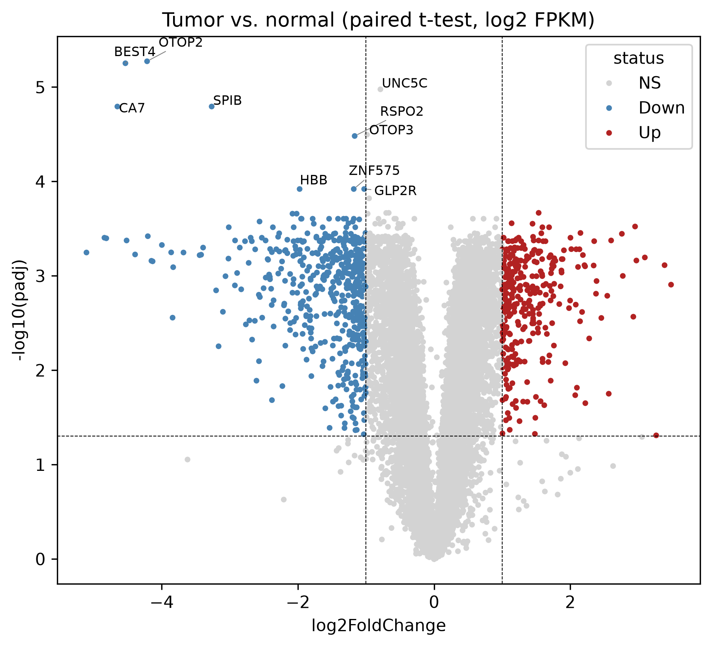
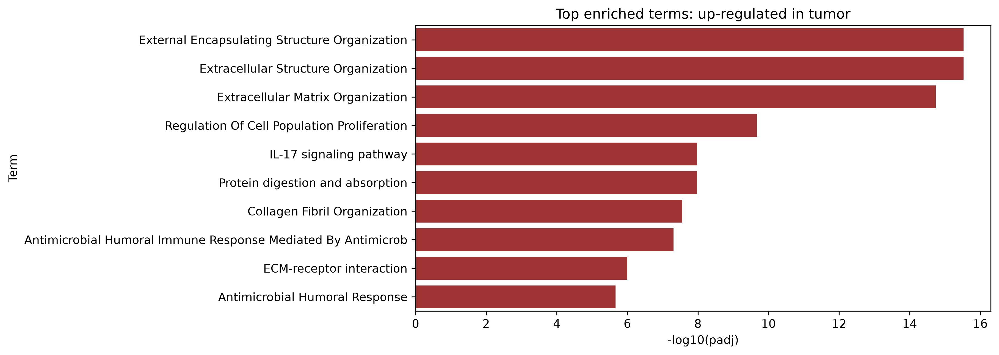
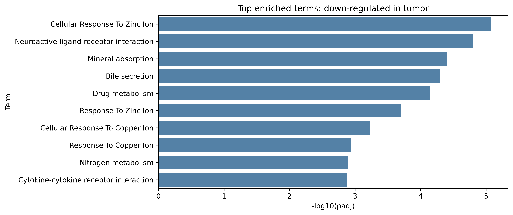

# Gene Expression Explorer: Colorectal Cancer (GSE50760)

Exploratory analysis of RNA-seq data from colorectal cancer patients: PCA, hierarchical clustering, paired differential expression, and pathway enrichment.

## Dataset
- **GEO accession:** [GSE50760](https://www.ncbi.nlm.nih.gov/geo/query/acc.cgi?acc=GSE50760)
- 54 samples from 18 patients: primary tumor, matched normal colon, and liver metastasis
- Platform: Illumina HiSeq 2000
- Only FPKM values were available on GEO (no raw counts)

## Methods
1. Combined 54 per-sample FPKM files into one genes x samples table and labelled samples using GEO metadata.
2. Filtered genes (FPKM >= 1 in at least 10 samples): 23,503 -> 14,217 genes. Applied log2(FPKM + 1).
3. PCA (standardized genes) and hierarchical clustering (Ward) of the 500 most variable genes. K-means on the top 5 PCs.
4. Differential expression, tumor vs. matched normal: paired t-test on log2(FPKM + 1) across 18 patients, Benjamini-Hochberg FDR. Significant = FDR < 0.05 and |log2FC| > 1.
5. Enrichment of up and down gene lists with Enrichr (GO Biological Process 2023, KEGG 2021 Human) via gseapy, using the 14,217 tested genes as background.

## Results





- **Clustering:** Normal colon samples cluster tightly; tumors are more spread out; metastases (liver tissue) separate from colon samples. K-means with k=3 had the best silhouette (0.43), but agreement with the true labels was moderate (ARI = 0.38).
- **Differential expression:** 328 genes up and 528 down in tumor vs. normal.
- **Top down-regulated genes:** OTOP2, BEST4, SPIB, CA7. Known colon markers also dropped: CA1, CA2, GUCA2A, GUCA2B (log2FC -3.7 to -5.1).
- **Up-regulated:** MMP1 (log2FC 3.1) and MMP7 (2.8). Enrichment shows extracellular matrix organization, collagen fibril organization, cell proliferation, IL-17 signaling and ECM-receptor interaction.
- **Down-regulated:** enrichment for mineral absorption, bile secretion, drug metabolism, and zinc/copper ion responses (these terms largely share the same metallothionein genes).





## Limitations
- FPKM only, so DESeq2/edgeR were not used. A paired t-test on log2(FPKM + 1) is less suited to count data, and the pseudocount compresses fold changes of lowly expressed genes.
- Small sample size (18 pairs); no independent validation dataset.
- Overlapping GO terms are not independent findings.
- The metastasis group was only used for QC and visualization, not in the tumor vs. normal comparison.

## Reproduce
```bash
conda create -n geo-explorer python=3.11
conda activate geo-explorer
pip install pandas numpy matplotlib seaborn scikit-learn scipy statsmodels gseapy GEOparse adjustText jupyterlab
jupyter lab
```
Run `notebooks/analysis.ipynb` from top to bottom (internet is needed to download the data and for Enrichr).

## Reference
Data from GEO series GSE50760. Please see the GEO page for the full citation.